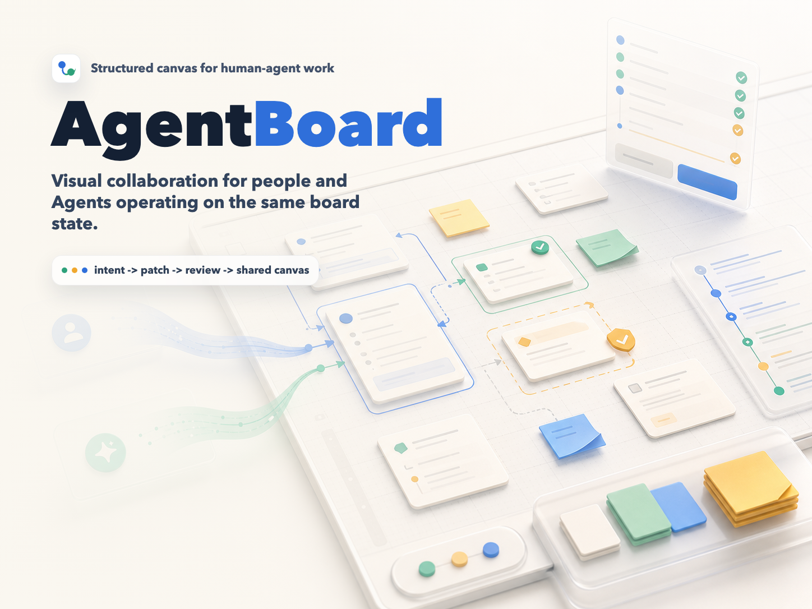

# AgentBoard

AgentBoard is an open-source whiteboard that runs in the browser. You and an agent can edit cards, connections, groups, and interactive components on the same canvas, then export your work as Markdown.

[中文](./README.md) · [Changelog](./CHANGELOG.md) · [Security and privacy](./SECURITY.md) · [Contributing](./CONTRIBUTING.md)



## What's new in v0.6.0

- **One editable canvas.** Edit content, interact with components, and adjust layout in the same view. Smart Layout arranges cards by their relationships, with local rules available before agent setup. Section navigation and overview help you find content.
- **Interactive components.** Agents can build HTML, SVG, and JavaScript charts, comparison matrices, and calculators. Slider values and other interaction state persist with the board. Reference an element to bring its current state into a follow-up.
- **Built-in interactive example.** Open the pricing and growth sandbox from an empty board without configuring a CLI or API key. The example uses simulated data.
- **Actions for selected cards.** Select a single card to elaborate, identify risks, create a visual, or change its semantic role while keeping custom tags. Select multiple cards to compare, connect, synthesize, group, or duplicate them.
- **Markdown cards.** Use headings, lists, quotes, links, and clickable checklists. Paste a URL to create a source card or paste a checklist to keep all its tasks.
- **Board goals and on-demand insights.** Set the goal and constraints for a board. Agent requests and Smart Layout use this context. Use AI Insights to check the whole board for gaps, synthesize conclusions, or generate an interactive sandbox. Both toolbar menus open over the canvas.
- **Review and export.** Review proposed rewrites and deletions before applying them. Each board keeps up to 25 undo and redo steps. Export the whole board or selected cards as Markdown, including groups, checklist state, interactive parameters, and connections. On a narrow screen, open the export dialog from the board menu. Use `.agentboard.json` for board backups.

An upgrade from v0.5.0 migrates saved goals and constraints into the board settings. The separate exploration mode, background suggestions, and TypeSafe checks have been removed.

## Quick start

Use Node.js 22.12 or a later 22.x release, or Node.js 24.

```bash
git clone https://github.com/AyingAI/agentboard.git
cd agentboard
npm ci
npm run dev -- --host 127.0.0.1
```

Open the address shown in the terminal, usually `http://127.0.0.1:5173/`. An empty board offers an interactive example, four starter prompts, and manual card creation.

## Connect an agent

| Connection | Setup |
| --- | --- |
| Local CLI | Install and sign in to a CLI, then select it in Agent Settings. Supported tools include Claude Code, Codex, Gemini, Antigravity, Pi, and OpenCode. |
| Claude API | Select a model and enter an API key. You can configure a compatible Base URL. |
| OpenAI-compatible API | Set the Base URL first, then enter your API key, model, and output budget. Compatible services include Ollama and DeepSeek. |

API connections use HTTPS, with HTTP available for loopback services. Enter the appropriate key after changing the provider or effective API address. The development server provides the local CLI bridge. Static builds support manual boards, the built-in example, and direct API connections from the browser.

## Data and privacy

- The current browser stores boards, activity, and API settings in `localStorage`. The app sends the API key in an authentication header to the configured endpoint when you use that connection.
- Submitting an agent request sends the prompt and board context to your selected CLI or API. Whole-board insights use every card's body. The CLI and its provider determine how the CLI handles data and which tools it can use.
- Markdown and JSON exports can include card text, source URLs, and interactive state. JSON also includes interactive source code. Review the content before sharing it.

See the [security policy](./SECURITY.md) for data handling and vulnerability reporting.

## Development and testing

```bash
npm run typecheck
npm test
npm run test:e2e
npm run build
```

Browser tests use Chrome on macOS and Playwright Chromium on other platforms. The default suite uses test responses. Opt-in live CLI tests require a signed-in CLI and use model quota.

AgentBoard uses the [MIT license](./LICENSE).
