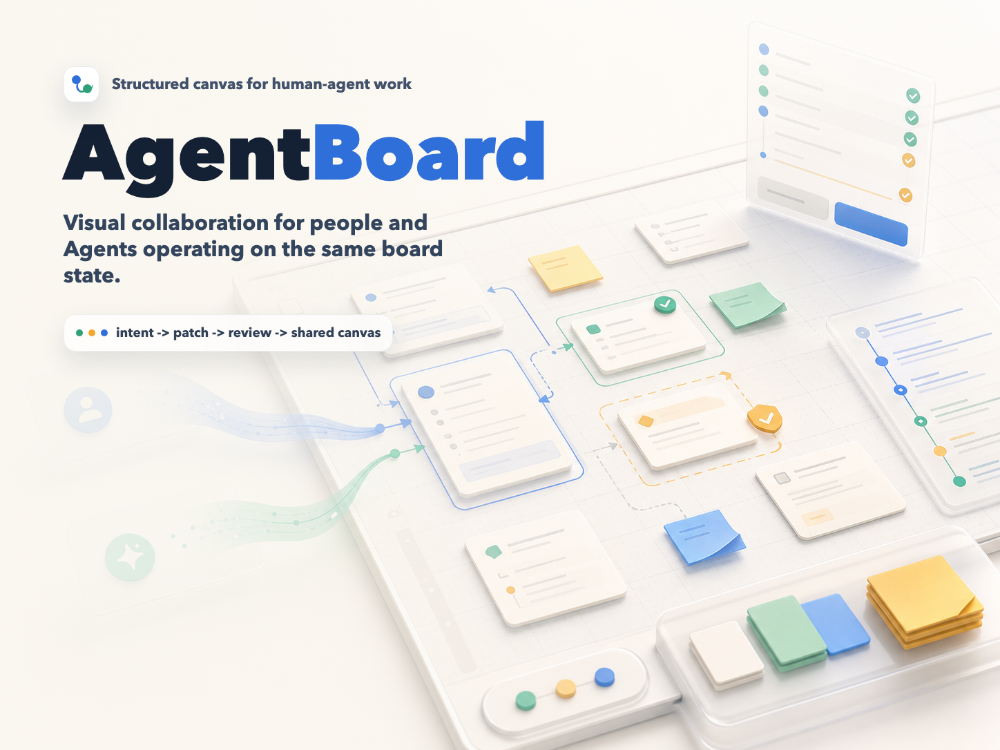
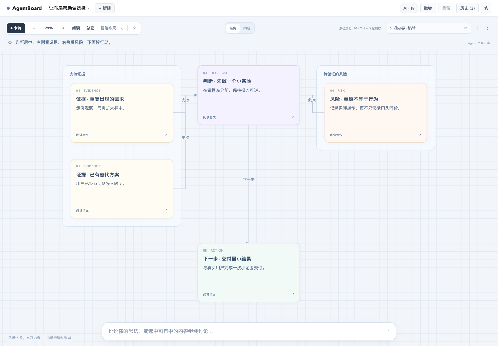

# AgentBoard

**Think with AI on the same canvas, with content you can understand, operate and keep evolving.**

AgentBoard is a local-first visual collaboration canvas. Describe a question or an idea, let an agent create diagrams, interactive charts, simulations or runnable prototypes, then explore the relationships, operate the details and continue refining them together. Models choose how to express ideas; the canvas provides presentation, interaction and reviewable collaboration.

[中文](./README.md) · [Changelog](./CHANGELOG.md) · [Contributing](./CONTRIBUTING.md)



## v0.3.7: layout that helps explain content

Choose “智能布局” to ask the configured agent to read actual board content, visual state, groups and connections, then organize meaningful spatial relationships. Compare alternatives side by side, connect evidence to a decision, and give risks and next steps their own place. New generations can return a spatial plan in the same response.

- **Organize by meaning:** recursively compose rows, columns and orbits to express comparisons, arguments, hierarchies and flows. The host lays out measured content; models can also preserve custom coordinates.
- **Explore structure, then detail:** the structure view shows summaries and existing relationships. Open a node to read its original text or operate its original visual; switch to the content canvas for editing and dragging.
- **Keep layout changes focused:** clicking smart layout authorizes spatial organization. Host policy rejects content additions, rewrites and deletions in this task, retains visual source and parameters, supports undo and checks for edits made while planning.
- **Keep quick cleanup available:** “仅整理间距” adjusts spacing and collisions. Without an agent, smart layout uses clearly labeled local rules based on existing groups, connections and tags.



An example scenario from browser regression tests: evidence on the left supports the central decision, risk on the right constrains it, and the next action follows below. Every node opens its original content.

## Open interactive visualization

Agents can use HTML, SVG and JavaScript to turn a conversation into canvas content that users can inspect, operate and refine.

- **Generate visualizations:** describe a problem and let the agent choose a diagram, interactive chart, explainer, simulation or runnable prototype.
- **Interact directly:** adjust parameters, switch conditions and observe results. Interaction state persists with the board across reloads and expansion.
- **Discuss specific details:** reference an element or discuss a visual with its source, current parameters and selected detail in context. Compare the agent's proposed revision before accepting it.
- **Keep expression open:** models author the visual content without a fixed component catalog. Combine visuals with cards, notes, groups and connections.

For example:

> Turn browser caching into an interactive visualization. Let me switch cache conditions and observe how request paths and results change. Save my choices so I can reference a detail and ask a follow-up.

Before connecting an agent, try the included compound-interest lab and change its parameters to explore the interaction.

## Quick start

Use Node.js 20.19+ or 22.12+; Node.js 22 or newer is recommended.

```bash
git clone https://github.com/AyingAI/agentboard.git
cd agentboard
npm ci
npm run dev -- --host 127.0.0.1
```

Open the local URL printed in the terminal, normally `http://127.0.0.1:5173`.

- **Try it first:** choose the interactive example on an empty canvas. The included compound-interest lab is pregenerated and works without an agent or a model call.
- **Connect an agent:** open settings and select an installed, authenticated local CLI, or configure Claude / an OpenAI-compatible API.
- **Start collaborating:** choose a starter task or activate the floating input strip. Select existing content to focus the next discussion on it.

To update an existing checkout and restart:

```bash
git pull --ff-only
npm ci
npm run dev -- --host 127.0.0.1
```

## Supporting experience improvements

- **More canvas space:** the centered floating composer starts as a compact strip, expands on activation and collapses when empty and dismissed. Both sides of the canvas remain usable. Stop a run or write the next draft while waiting.
- **Continuity:** boards keep separate drafts, run records and pending proposals across reloads and board switches. One-click next steps execute without replacing an unsent draft.
- **Reviewable changes:** low-risk additions apply directly; content rewrites and node/edge/group deletions require confirmation. Compare versions and protect later human edits from stale proposals. Clicking smart layout already authorizes that spatial change, without another confirmation step.
- **Overview to reading:** numbered sections match the reading bar. Overview labels remain readable at low zoom and open a section in reading view. Searchable content navigation and wheel panning help explore larger boards.
- **Simpler board management:** switch, import and export from the title menu. A delete button changes in place to “确认删除”; click again to delete, or close the menu to cancel.

See the [changelog](./CHANGELOG.md) for the complete history.

## A typical workflow

1. Ask the agent to compare three product directions and identify assumptions and validation methods.
2. Explore the structure first. For an existing board, choose “智能布局” to reorganize it, then open a node for its original content.
3. Adjust visual parameters or switch to the content canvas to edit and move cards. Select relevant cards to continue the discussion; visuals support detail references and discussion of their current state.
4. Compare proposed changes before accepting or rejecting them.
5. Execute a suggested next step or write your own; undo or export a backup when needed.

This supports idea exploration, explanations, experiment design and simulations. Research and business conclusions still need real sources and observed data; example parameters and simulated outcomes do not validate real-world demand.

## Connect an agent

| Provider | Best fit | Setup |
| --- | --- | --- |
| Local CLI | Existing agent authentication, tools and skills | Install and authenticate a CLI, then select it in settings |
| Claude API | API reasoning and structured output | API key, model and optional API URL |
| OpenAI-compatible API | OpenAI or a compatible service | API key, base URL, model and output budget |

Detection supports Claude Code, OpenCode, Pi, Codex, Gemini, Antigravity, Qwen Code, Cursor Agent, GitHub Copilot CLI, Qoder, Kimi and Trae. Settings show the detected version and exact executable path. Use refresh after installing or upgrading a CLI.

CLI mode reuses local capabilities. API mode does not automatically have file, command or search tools. API requests originate in the browser, so the endpoint must allow the appropriate cross-origin requests. API keys and settings stay in browser `localStorage` and are not written to the repository.

**The local CLI bridge works only in the Vite development server.** The output of `npm run build` and the `npm run preview` server do not include a CLI backend. Keep the development server local: it can launch supported CLIs on your machine.

## Controls

The interface currently uses Chinese labels.

| Action | Interaction |
| --- | --- |
| Write and send | Activate the bottom strip; Enter sends, Shift + Enter adds a line |
| Create card | Click “+ 卡片” or double-click empty canvas |
| Edit text | Double-click a card's title or body |
| Move cards | Drag; marquee-select to move several cards |
| Connect nodes | Drag a selected node's connector to another node |
| Edit edge label | Select or double-click the label |
| Delete selection | Delete / Backspace |
| Browse and zoom | Wheel pans; Cmd/Ctrl + wheel zooms |
| Pan | Space + drag or middle-button drag |
| Smart layout | “智能布局” asks the configured agent to organize relationships; local rules apply without an agent |
| Spacing cleanup | Open the menu beside “智能布局” and choose “仅整理间距” |
| Structure / content | Use “结构” / “内容” on multi-node boards; open a structure node, then “在内容画布中查看” to edit it |
| Reading / overview | “阅读” / “总览”, or jump through content navigation |
| Undo / redo | Cmd/Ctrl + Z / Cmd/Ctrl + Shift + Z; Windows also supports Ctrl + Y |
| Shortcuts | Click “?” or press ? |
| Manage boards | Click the title for the menu; double-click it to rename |

## Save, recover and back up

- Boards, drafts, run records, interaction state and pending proposals stay in the current browser.
- Each board retains up to 25 undo/redo steps across reloads and board switches.
- Export `.agentboard.json` from the board menu. Imports accept that format or raw `BoardDSL`, validate it and open it as a new board.
- Saves attempt to retain a previous local copy. Missing or corrupt primary data triggers backup recovery when available; unavailable or full storage shows an export action.
- Board exports include canvas content and visual state, excluding agent keys, conversation drafts and the complete run history.
- Board deletion cannot be undone, and at least one board is kept. Export important work first. Clearing browser data removes local work; cloud sync and automatic cross-device recovery are not available.

## Protocol and visual runtime

`src/types/dsl.ts` defines the shared protocol. Agents return validated `DSLPatch` operations rather than mutating the canvas directly. A request for a user answer or authorization uses `interaction_request`.

```ts
type DSLPatch = {
  type: 'dsl_patch';
  summary: string;
  ops: PatchOp[];
  presentation?: { layout: 'auto' | 'preserve'; plan?: SpatialPlan };
  actions?: { id: string; label: string; prompt: string; nodeIds?: string[] }[];
  questions?: string[]; // legacy suggestions
};

type SpatialPlan = { description: string; root: SpatialItem };
type SpatialItem =
  | { nodeId: string }
  | { groupId: string; direction?: 'row' | 'column' | 'orbit' }
  | { direction: 'row' | 'column' | 'orbit'; children: SpatialItem[]; label?: string };
```

Operations add, update or delete cards, notes, groups and edges, or adjust layout. Invalid references, duplicate IDs, invalid geometry or scope violations fail the batch atomically. Recent conversation and human edits inform later requests; selected nodes keep their complete body text in context.

With `layout: 'auto'`, `presentation.plan` describes semantic structure that the host projects into measured full-content geometry and a compact structure view. `layout: 'preserve'` retains model-authored coordinates without a plan. Plans reference existing or newly added nodes and do not broaden modification permissions. The dedicated smart-layout task accepts only `ops: []` and a plan covering all current nodes. Visual HTML/SVG/JavaScript remains open-ended model output.

Cards can carry open visual content:

```ts
visual: {
  html: string;
  state?: Record<string, unknown>;
  height?: number;
}
```

Visuals run in isolated iframes with this host bridge:

```js
const saved = agentboard.getState();
agentboard.setState({ years: 12 });
const unsubscribe = agentboard.onStateChange(state => render(state));
agentboard.ask('Continue from my parameters', { selectedOption: 'A' });
agentboard.reference('This result', 'result-element-id');
```

`ask()` only drafts a request for the user to send; a host next-step button can start an agent call directly. Native controls with stable IDs or names automatically persist in `state._inputs`. Omitting `state` when updating `visual.html` preserves current state.

Inline scripts and script libraries from jsDelivr, cdnjs, esm.sh and unpkg are supported. Visuals cannot access host storage, arbitrary network requests, remote images, nested iframes or top-level navigation. Complete responses are validated before visuals are applied. Progress shows actual activity, content clues and received characters, without invented percentages.

## Development and tests

```bash
npm run dev        # local development with the CLI bridge
npm run typecheck  # TypeScript validation
npm run test       # unit tests
npm run test:e2e   # isolated browser regression tests; no real model calls
npm run build      # build static output in dist/
npm run preview    # preview static output; no CLI bridge
```

Browser tests use installed Chrome on macOS and Playwright Chromium elsewhere. Run `npx playwright install chromium` if required.

Live CLI tests are explicit opt-ins. They use the installed CLI's authentication and model quota:

```bash
AGENTBOARD_LIVE_CLI=codex npm run test:e2e -- e2e/live-agent.spec.ts --workers=1
AGENTBOARD_LIVE_ACTIONS=pi npm run test:e2e -- e2e/live-actions.spec.ts --workers=1
AGENTBOARD_LIVE_COMPOSITION=pi npm run test:e2e -- e2e/board-composition.spec.ts -g "a real CLI" --workers=1
AGENTBOARD_LIVE_SPATIAL=pi npm run test:e2e -- e2e/semantic-layout.spec.ts -g "real CLI" --workers=1
```

v0.3.7 release validation: 238 unit tests passed; 58 browser tests passed with 4 live CLI cases skipped by default; the production build passed. A separate real Pi CLI spatial-planning call also verified that original text, visual source and interaction state were retained.

Raw test screenshots, traces, generated boards, build output and local runtime records are excluded from GitHub. Curated public example screenshots used by this README live in `assets/`. Useful regression tests remain in `src/**/__tests__`, `src/**/*.test.ts` and `e2e/`.

```text
src/
  types/          # board, agent and session protocols
  engine/         # patch application, validation and history
  agent/          # adapters, context, streaming and risk assessment
  server/         # CLI catalog, discovery and event parsing
  presentation/   # semantic plans, structure maps, measured geometry and layout
  visuals/        # visual contract and isolated runtime
  hooks/          # React state and interactions
  components/     # canvas, composer, settings and review
  storage.ts      # local persistence and recovery
agentBridgePlugin.ts # Vite CLI middleware
```

## Current boundaries

AgentBoard remains a prototype for local use, without accounts, hosted services, multiplayer collaboration or cloud sync. Output quality depends on the chosen model and available evidence; not every CLI or third-party API version combination has been verified.

See [CONTRIBUTING.md](./CONTRIBUTING.md) for contributions and [SECURITY.md](./SECURITY.md) for local bridge and credential considerations.

## License

[MIT](./LICENSE)
