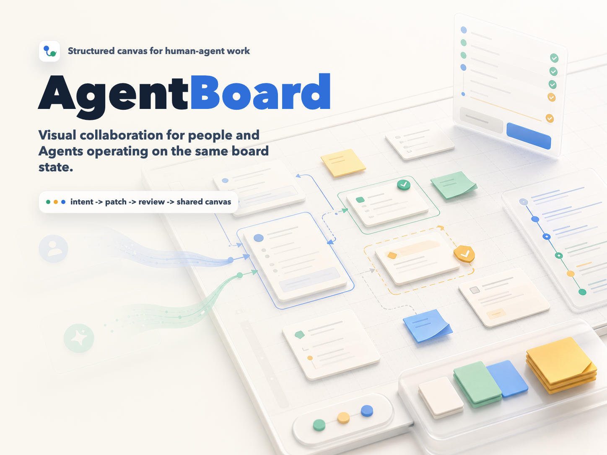

# AgentBoard

**用自然语言生成可交互可视化，和 AI 在同一张画布上持续共创。**

AgentBoard 是一个 local-first 的可视化协作画布。描述你想理解的问题或探索的方案，让 Agent 生成图解、交互图表、机制演示或可试用原型；直接操作其中的内容，再让 Agent 基于当前状态继续修改。

[English](./README.en.md) · [v0.3.5 更新记录](./CHANGELOG.md) · [贡献指南](./CONTRIBUTING.md)



## v0.3.5 核心更新：加入可交互可视化

这一版加入了开放式可视化生成与运行能力。Agent 可以用 HTML、SVG 和 JavaScript 自由组织表达，把对话中的想法变成可以查看、操作和继续完善的画布内容。

- **生成可视化**：用自然语言创建结构图、交互图表、解释器、模拟器和可试用原型，由 Agent 根据问题选择表达形式。
- **直接操作**：调整参数、切换条件、观察结果；交互状态随白板保存，刷新或重新展开后可以继续。
- **围绕细节共创**：点击“引用细节”或“与 Agent 讨论”，带上视觉源码、当前参数和所选元素继续追问，预览 Agent 对已有可视化的修改再采纳。
- **开放表达**：视觉内容由模型生成，没有固定组件目录；可以与卡片、便签、分组和连线组合使用。

例如，输入：

> 把浏览器缓存做成一个可交互的可视化：让我切换缓存条件，观察请求走向和结果变化。保存我的选择，方便我引用图中的细节继续追问。

还未连接 Agent 时，可先打开内置的“复利实验室”，调整参数体验这套可视化交互。

## 快速开始

需要 Node.js 20.19+ 或 22.12+，建议使用 Node.js 22 或更新版本。

```bash
git clone https://github.com/AyingAI/agentboard.git
cd agentboard
npm ci
npm run dev -- --host 127.0.0.1
```

打开终端显示的本地地址，默认是 `http://127.0.0.1:5173`。

- **先体验**：空白画布点击“先体验一个交互示例”，无需配置 Agent 即可操作内置复利实验室。示例是预生成内容，不会发起模型调用。
- **连接 Agent**：打开右上角设置，选择本机已安装并完成认证的 CLI，或配置 Claude / OpenAI 兼容 API。
- **开始共创**：选择起始任务，或点击底部输入条描述需求；选中已有内容后，可以围绕它继续讨论。

## 配套体验改进

- **更大的画布**：输入框默认收起为居中的悬浮小条，点击展开，空内容离开后收起；两侧仍可操作画布。生成中可停止，也可先写下一步草稿。
- **连续协作**：每张白板分别保存草稿、运行记录和待确认修改；刷新、切换白板后可以继续。Agent 的下一步建议可以一键执行，保留未发送草稿。
- **可审阅的修改**：新增等低风险操作直接应用；改写内容、删除节点/连线/分组、全图布局先确认。可以预览前后版本，旧提案不能覆盖后续人工修改。
- **可读的大画布**：按实际渲染尺寸避让卡片和分组；提供阅读视图、总览、内容导航和滚动浏览。
- **更顺畅的白板管理**：标题下拉菜单支持切换、导入、导出；删除按钮会原位变为“确认删除”，再次点击执行，关闭菜单则取消。

完整变更见 [CHANGELOG](./CHANGELOG.md)。

## 一次典型的协作

1. 输入“比较三种产品方向，帮我找出假设和验证方法”，让 Agent 选择合适的表达。
2. 直接移动卡片、编辑文字或操作视觉中的参数。
3. 选中相关卡片，继续提问；视觉也支持“引用细节”和“与 Agent 讨论”。
4. 在修改提案中查看前后变化，再决定采纳或放弃。
5. 点击可执行的下一步建议，或写下自己的下一步；需要时撤销、导出备份。

这条流程适合梳理想法、解释机制、设计实验和交互推演。调研与业务结论仍需要真实来源和实测数据；示例参数、假设和模拟结果不能当作验证结果。

## 连接 Agent

| 方式 | 适合的场景 | 配置 |
| --- | --- | --- |
| Local CLI | 使用本机 Agent 的认证、工具与 skills | 安装并登录 CLI，在设置中选择它 |
| Claude API | 通过 API 进行推理和结构化输出 | API key、模型及可选 API 地址 |
| OpenAI-compatible API | OpenAI 或兼容服务 | API key、base URL、模型和输出预算 |

支持检测 Claude Code、OpenCode、Pi、Codex、Gemini、Antigravity、Qwen Code、Cursor Agent、GitHub Copilot CLI、Qoder、Kimi 和 Trae。设置会显示检测到的版本与实际可执行路径；安装或升级后点击“重新检测”。

CLI 模式复用本机已有能力；API 模式不会自动获得文件、命令或搜索工具。API 请求从浏览器直接发出，服务端需要允许相应的跨域请求。API key 和设置保存在浏览器 `localStorage`，不会写入仓库。

**本地 CLI bridge 仅在 Vite 开发服务器中可用。** `npm run build` 的产物和 `npm run preview` 不包含 CLI 后端。开发服务器可以启动本地 CLI，应保持仅本机访问。

## 操作速查

| 操作 | 方法 |
| --- | --- |
| 输入与发送 | 点击底部输入条；Enter 发送，Shift + Enter 换行 |
| 创建卡片 | 左上角“+ 卡片”，或双击画布空白处 |
| 编辑文字 | 双击卡片标题或正文 |
| 移动卡片 | 拖拽；框选后可批量移动 |
| 创建连线 | 选中节点，从连接点拖到另一个节点 |
| 编辑连线标签 | 选中或双击连线标签 |
| 删除选中内容 | Delete / Backspace |
| 浏览与缩放 | 滚轮浏览；Cmd/Ctrl + 滚轮缩放 |
| 平移画布 | Space + 拖拽，或鼠标中键拖拽 |
| 阅读 / 总览 | 使用左上角“阅读”“总览”，或通过内容导航跳转 |
| 撤销 / 重做 | Cmd/Ctrl + Z / Cmd/Ctrl + Shift + Z；Windows 也支持 Ctrl + Y |
| 查看快捷键 | 点击“?”或按 ? |
| 白板管理 | 点击顶部标题打开菜单；双击标题重命名 |

## 保存、恢复与备份

- 白板、草稿、运行记录、交互状态和待确认修改保存在当前浏览器。
- 每张白板保存最多 25 步撤销/重做历史；刷新或切换白板后仍可使用。
- 白板菜单可导出 `.agentboard.json`，也可导入该格式或原始 `BoardDSL`。导入会先校验，再作为新白板打开。
- 保存时尝试保留上一份本地副本；主数据缺失或损坏时尝试恢复备份并提示用户。存储不可用或已满时显示导出入口。
- 白板导出包含画布和视觉状态，不包含 Agent 密钥、聊天草稿及完整运行历史。
- 删除白板不可撤销，至少保留一张白板；重要内容请先导出。清除浏览器数据会清除本地工作，不支持云同步或跨设备自动恢复。

## 协议与视觉运行时

`src/types/dsl.ts` 是共享协议的来源。Agent 返回经过校验的 `DSLPatch`，而不是直接修改画布；需要用户回答或授权时返回 `interaction_request`。

```ts
type DSLPatch = {
  type: 'dsl_patch';
  summary: string;
  ops: PatchOp[];
  actions?: { id: string; label: string; prompt: string; nodeIds?: string[] }[];
  questions?: string[]; // 兼容旧版建议
};
```

支持卡片、便签、分组、连线的增删改和布局操作。无效引用、重复 ID、无效几何或超出授权范围会使整批修改失败，不会留下半更新状态。近期对话和人工编辑会作为后续上下文，所选节点会保留完整正文。

卡片可附带开放式视觉内容：

```ts
visual: {
  html: string;
  state?: Record<string, unknown>;
  height?: number;
}
```

视觉在隔离 iframe 中运行，常用接口如下：

```js
const saved = agentboard.getState();
agentboard.setState({ years: 12 });
const unsubscribe = agentboard.onStateChange(state => render(state));
agentboard.ask('根据我的参数继续分析', { selectedOption: 'A' });
agentboard.reference('这个结果', 'result-element-id');
```

`ask()` 只起草请求，由用户在宿主输入框发送；宿主的下一步建议按钮才会直接发起一次 Agent 调用。带稳定 `id` 或 `name` 的原生控件会自动保存到 `state._inputs`。更新 `visual.html` 时省略 `state` 即保留已有状态。

支持内联脚本及 jsDelivr、cdnjs、esm.sh、unpkg 的脚本库。视觉不能访问宿主存储、任意网络请求、远程图片、嵌套 iframe 或顶层导航。最终视觉在完整响应校验后应用；运行中展示真实活动、内容线索和接收字符数，不估算虚假进度。

## 开发与测试

```bash
npm run dev        # 本地开发，包含 CLI bridge
npm run typecheck  # TypeScript 校验
npm run test       # 单元测试
npm run test:e2e   # 隔离浏览器回归，不调用真实模型
npm run build      # 生成 dist/ 静态产物
npm run preview    # 预览静态产物，不含 CLI bridge
```

浏览器测试在 macOS 使用已安装的 Chrome，其他平台使用 Playwright Chromium，必要时先运行 `npx playwright install chromium`。

真实 CLI 测试需要显式开启，会使用已安装 CLI 的认证与模型配额：

```bash
AGENTBOARD_LIVE_CLI=codex npm run test:e2e -- e2e/live-agent.spec.ts --workers=1
AGENTBOARD_LIVE_ACTIONS=pi npm run test:e2e -- e2e/live-actions.spec.ts --workers=1
```

测试截图、trace、生成白板、构建产物和本地运行记录均不提交到 GitHub。有效回归测试保留在 `src/**/__tests__`、`src/**/*.test.ts` 和 `e2e/`。

```text
src/
  types/          # 白板、Agent 与 session 协议
  engine/         # patch 应用、校验和事务历史
  agent/          # 适配器、上下文、流式响应与风险评估
  server/         # CLI 目录、发现与事件解析
  presentation/   # 实测尺寸与布局避让
  visuals/        # 视觉协议与隔离运行时
  hooks/          # React 状态和交互
  components/     # 画布、输入框、设置和审阅界面
  storage.ts      # 本地保存与恢复
agentBridgePlugin.ts # Vite CLI 中间件
```

## 当前边界

AgentBoard 仍是面向本机使用的原型，没有账号系统、托管服务、多人协作或云同步。模型输出的内容质量取决于所用模型和可用证据；所有 CLI 和第三方 API 的版本组合并未逐一验证。

问题反馈与贡献见 [CONTRIBUTING.md](./CONTRIBUTING.md)，本地桥接与密钥注意事项见 [SECURITY.md](./SECURITY.md)。

## License

[MIT](./LICENSE)
