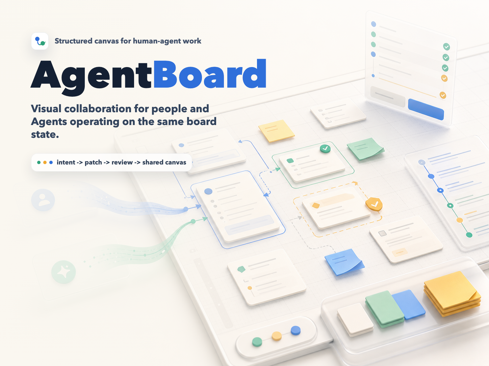
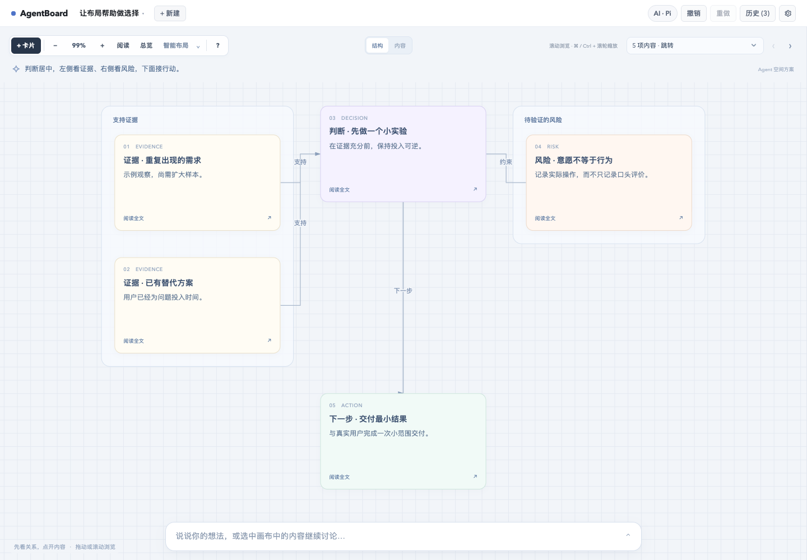

# AgentBoard

**和 AI 在同一张画布上思考，让内容可以看懂、操作和持续演进。**

AgentBoard 是一个 local-first 的可视化协作画布。描述你想理解的问题或探索的方案，让 Agent 生成图解、交互图表、机制演示或可试用原型；先看清整体关系，再进入细节操作，让 Agent 基于当前状态继续修改。模型自由选择表达方式，画布负责呈现、交互与可审阅的协作。

[English](./README.en.md) · [更新记录](./CHANGELOG.md) · [贡献指南](./CONTRIBUTING.md)



## v0.5.0 · 交付前核对依据

在「Agent 设置 → 交付前核对依据」配置 TypeSafe 连接并开启。根据一份明确原文改写已有研究卡片时，JEV 会核对草案中的事实句。发现明确问题后，主 Agent 最多局部修订一次，你可以在原修改预览中确认、应用和撤回。核查、修订和复核合计最多等待 15 秒。服务失败时保留草案，已发现且尚未解决的问题会显示在相应卡片的预览中。

此功能默认关闭。开启后会向 TypeSafe 发送相关原文和草案句子，密钥保存在此浏览器。已有的原文核查选择会保留，旧 JEV 后台配置只迁移连接信息。静态部署需要 TypeSafe 允许跨域。后台的多卡影响判断由主 Agent 和本地召回完成，未打标签的执行卡也可进入候选。未覆盖的卡片或未读全的正文会标出。

## 让 Agent 主动准备结果

从“研究一个选题”或“策划一次活动或旅行”开始，放入一个问题和第一条资料。连接 Agent 后，新材料、内容修改或条件变化会触发主动分析；无需先在聊天框想好一条指令。首页只保留两个任务入口、对应示例和自由开始；有内容后再显示缩放与布局工具。

- **自动命名白板**。默认名会在 Agent 首次写入内容时换成贴合主题的短标题。需要审阅的草稿在确认应用后命名，手动命名优先。
- **运行状态动效**。空白板生成时，连线和卡片会依次亮起。已有内容的白板在输入框上方显示运行状态和内容线索，执行详情可在历史中查看。

- **带着成果反馈**。有建议时，输入框上方会显示摘要。点「查看建议」可在历史侧栏阅读完整草稿、查看依据或定位原卡片。只保存网址时，未读取的网页不会作为证据。
- **沿着你的方向继续**。在「历史 → Agent 建议 → 白板分析设置」中可以补充目标与条件。已保留、暂不采用的建议随白板保存，并成为后续讨论的上下文。依据变化后，旧建议移到待复查记录。
- **看清变化的影响**。改动条件或资料后，发现区优先查看少量已有方案和结论，区分需要调整、先核实和可以沿用的部分。点成果标题回到原卡片，或直接打开准备好的调整草案。
- **你决定进入白板的内容**：“保留到白板”保存小成果并连接原资料，可撤销；点击具体的下一步会发起一次正常 Agent 任务，结果先供审阅。后台发现不会自行改写原文。
- **可控的节奏**。只在当前可见白板的内容提交后自动分析，打字和前台任务优先。自动分析会使用已连接的模型额度，每板默认每天最多 12 次。可在「目标与条件 → 自动分析设置」调整或取消上限，也可以暂停自动分析。手动分析和对话可以继续使用。

两个场景共享这些能力，分析重点不同：研究型任务把材料联系到观点和证据范围；体验策划把受众、主题、参与活动和条件变化联系起来。未连接 Agent 时，仍可使用示例、资料整理、续接标记和 Markdown 成果草稿。

后台 CLI 分析支持 Codex、Claude Code、Pi，使用比手动任务更窄的执行配置；其他 CLI 仍可手动讨论。Claude API 和 OpenAI 兼容 API 也支持主动分析。普通白板在内容提交后自动分析，打开时保持安静。示例白板可在白板分析设置中启用。当前版本不在关闭页面后监控，也不自动抓取外部资料。

## 让布局帮助理解内容

点击“智能布局”，当前 Agent 会读取白板的真实内容、交互状态、分组和连线，组织有意义的空间关系：比较的方向并排，证据靠近判断，风险与行动各有位置。新生成内容也可以在同一轮返回空间方案。

- **按内容组织**：空间方案可以递归组合行、列与环绕关系，表达比较、论证、层级和流程。宿主按实测尺寸排布，模型也可以保留自定义坐标。
- **先看结构，再读细节**：结构视图呈现摘要与已有关系，点击节点打开完整文字或原始交互可视化；切到内容视图继续编辑、拖动和共创。
- **只整理布局**：主动点击“智能布局”会授权一次空间整理；宿主拒绝这次操作增删或改写内容，保留视觉源码与参数，支持撤销，并检查等待期间的编辑冲突。
- **保留快速整理**：布局菜单中的“仅整理间距”处理间距与碰撞。未连接 Agent 时，智能布局使用明确标注的本地规则，依据已有分组、关系和标签组织内容。



浏览器回归测试中的示例场景：左侧证据支持中间判断，右侧风险约束判断，下方承接下一步行动。点击任一节点即可阅读原文。

## 开放式交互可视化

Agent 可以用 HTML、SVG 和 JavaScript 自由组织表达，把对话中的想法变成可以查看、操作和继续完善的画布内容。

- **生成可视化**：用自然语言创建结构图、交互图表、解释器、模拟器和可试用原型，由 Agent 根据问题选择表达形式。
- **直接操作**：调整参数、切换条件、观察结果；交互状态随白板保存，刷新或重新展开后可以继续。
- **围绕细节共创**：点击“引用细节”或“与 Agent 讨论”，带上视觉源码、当前参数和所选元素继续追问，预览 Agent 对已有可视化的修改再采纳。
- **开放表达**：视觉内容由模型生成，没有固定组件目录；可以与卡片、便签、分组和连线组合使用。

例如，输入：

> 把浏览器缓存做成一个可交互的可视化：让我切换缓存条件，观察请求走向和结果变化。保存我的选择，方便我引用图中的细节继续追问。

还未连接 Agent 时，可以从首页查看选题研究或活动策划示例，再开始自己的任务。

## 快速开始

需要 Node.js 20.19+ 或 22.12+，建议使用 Node.js 22 或更新版本。

```bash
git clone https://github.com/AyingAI/agentboard.git
cd agentboard
npm ci
npm run dev -- --host 127.0.0.1
```

打开终端显示的本地地址，默认是 `http://127.0.0.1:5173`。

- **从自己的任务开始**：在空白画布选择“研究一个选题”或“策划一次活动或旅行”，输入问题并放入第一条资料。两个场景都可以先看示例，无需连接 Agent。
- **沿着线索探索**：用“添加资料”保存链接、摘录或笔记。连接 Agent 后可查看主动准备的发现，也可以点“继续探索”选取要讨论的卡片，建议由你决定是否保存。
- **回来继续，带走成果**：选中一条卡片标记下次继续的位置。可以从整张白板或选中的线索整理选题提纲或体验方案，编辑后复制 Markdown。

已有本地项目可以更新后重新启动：

```bash
git pull --ff-only
npm ci
npm run dev -- --host 127.0.0.1
```

## 配套体验改进

- **更大的画布**：输入框默认收起为居中的悬浮小条，点击展开，空内容离开后收起；两侧仍可操作画布。生成中可停止，也可先写下一步草稿。
- **连续协作**：每张白板分别保存草稿、运行记录和待确认修改；刷新、切换白板后可以继续。Agent 的下一步建议可以一键执行，保留未发送草稿。
- **可审阅的修改**：新增等低风险操作直接应用；改写内容、删除节点/连线/分组等修改先确认。可以预览前后版本，旧提案不能覆盖后续人工修改。主动点击“智能布局”已授权本次空间整理，无需重复确认。
- **从总览进入阅读**：板块编号与顶部阅读导航对应；缩小时板块标题保持可读，点击即可进入该板块。支持内容搜索、逐项跳转和滚动浏览。
- **更顺畅的白板管理**：标题下拉菜单支持切换、导入、导出；删除按钮会原位变为“确认删除”，再次点击执行，关闭菜单则取消。

完整变更见 [CHANGELOG](./CHANGELOG.md)。

## 一次典型的协作

1. 输入“比较三种产品方向，帮我找出假设和验证方法”，让 Agent 选择合适的表达。
2. 在结构视图看清整体；已有白板可以点击“智能布局”重新组织，点击节点进入原始内容。
3. 操作视觉中的参数，或切到内容视图编辑、移动卡片；选中相关卡片继续提问，视觉也支持“引用细节”和“与 Agent 讨论”。
4. 在修改提案中查看前后变化，再决定采纳或放弃。
5. 点击可执行的下一步建议，或写下自己的下一步；需要时撤销、导出备份。

这条流程适合梳理想法、解释机制、设计实验和交互推演。调研与业务结论仍需要真实来源和实测数据；示例参数、假设和模拟结果不能当作验证结果。

## 连接 Agent

| 方式 | 适合的场景 | 配置 |
| --- | --- | --- |
| Local CLI | 使用本机 Agent 的认证、工具与 skills | 安装并登录 CLI，在设置中选择它 |
| Claude API | 通过 API 进行推理和结构化输出 | API key、模型及可选 API 地址 |
| OpenAI-compatible API | OpenAI 或兼容服务 | API key、base URL、模型和输出预算 |

支持检测 Claude Code、OpenCode、Pi、Codex、Gemini、Antigravity、Qwen Code、Cursor Agent、GitHub Copilot CLI、Qoder、Kimi 和 Trae。设置会显示检测到的版本与实际可执行路径；安装或升级后点击“重新检测”。

首次连接优先选择已安装的 Pi，未安装时从实际可用的工具中选择；已有选择会保留。CLI 模式复用本机已有能力；API 模式不会自动获得文件、命令或搜索工具。API 请求从浏览器直接发出，服务端需要允许相应的跨域请求。API key 和设置保存在浏览器 `localStorage`，不会写入仓库。

**本地 CLI bridge 仅在 Vite 开发服务器中可用。** `npm run build` 的产物和 `npm run preview` 不包含 CLI 后端。开发服务器可以启动本地 CLI，应保持仅本机访问。

## 操作速查

| 操作 | 方法 |
| --- | --- |
| 输入与发送 | 点击底部输入条；Enter 发送，Shift + Enter 换行 |
| 创建卡片 | 左上角“+ 卡片”，或双击画布空白处 |
| 编辑文字 | 双击卡片标题或正文 |
| 移动卡片 | 拖拽；框选后可批量移动 |
| 创建连线 | 选中节点，从连接点拖到另一个节点 |
| 编辑连线标签 | 选中或双击连线标签 |
| 删除选中内容 | Delete / Backspace |
| 浏览与缩放 | 滚轮浏览；Cmd/Ctrl + 滚轮缩放 |
| 平移画布 | Space + 拖拽，或鼠标中键拖拽 |
| 智能布局 | 点击“智能布局”，由当前 Agent 组织内容关系；未配置时使用本地规则 |
| 仅整理间距 | 打开“智能布局”旁的菜单，选择“仅整理间距” |
| 结构 / 内容 | 多节点白板使用顶部切换；点击结构节点查看原文，选择“在内容画布中查看”进入编辑 |
| 阅读 / 总览 | 使用左上角“阅读”“总览”，或通过内容导航跳转 |
| 撤销 / 重做 | Cmd/Ctrl + Z / Cmd/Ctrl + Shift + Z；Windows 也支持 Ctrl + Y |
| 查看快捷键 | 点击“?”或按 ? |
| 白板管理 | 点击顶部标题打开菜单；双击标题重命名 |

## 保存、恢复与备份

- 白板、草稿、运行记录、交互状态、待确认修改，以及目标、条件和主动发现保存在当前浏览器。
- 每张白板保存最多 25 步撤销/重做历史；刷新或切换白板后仍可使用。
- 白板菜单可导出 `.agentboard.json`，也可导入该格式或原始 `BoardDSL`。导入会先校验，再作为新白板打开。
- 保存时尝试保留上一份本地副本；主数据缺失或损坏时尝试恢复备份并提示用户。存储不可用或已满时显示导出入口。
- 白板导出包含画布和视觉状态，不包含 Agent 密钥、聊天草稿、主动协作记录及完整运行历史；已保留到画布的发现会随画布导出。
- 删除白板不可撤销，至少保留一张白板；重要内容请先导出。清除浏览器数据会清除本地工作，不支持云同步或跨设备自动恢复。

## 协议与视觉运行时

`src/types/dsl.ts` 是共享协议的来源。Agent 返回经过校验的 `DSLPatch`，而不是直接修改画布；需要用户回答或授权时返回 `interaction_request`。

```ts
type DSLPatch = {
  type: 'dsl_patch';
  summary: string;
  boardTitle?: string; // 默认名白板首次写入内容时的建议标题
  ops: PatchOp[];
  presentation?: { layout: 'auto' | 'preserve'; plan?: SpatialPlan };
  actions?: { id: string; label: string; prompt: string; nodeIds?: string[] }[];
  questions?: string[]; // 兼容旧版建议
};

type SpatialPlan = { description: string; root: SpatialItem };
type SpatialItem =
  | { nodeId: string }
  | { groupId: string; direction?: 'row' | 'column' | 'orbit' }
  | { direction: 'row' | 'column' | 'orbit'; children: SpatialItem[]; label?: string };
```

支持卡片、便签、分组、连线的增删改和布局操作。无效引用、重复 ID、无效几何或超出授权范围会使整批修改失败，不会留下半更新状态。近期对话和人工编辑会作为后续上下文，所选节点会保留完整正文。

`presentation.plan` 在 `layout: 'auto'` 时提供语义空间结构，由宿主分别投影为实测完整内容布局与紧凑结构视图；`layout: 'preserve'` 保留模型自定义坐标，不携带 plan。空间方案引用现有节点或本次新增节点，不扩大修改权限。“智能布局”专用任务只接受 `ops: []` 与覆盖当前全部节点的方案。视觉的 HTML/SVG/JavaScript 仍由模型自由生成。

卡片可附带开放式视觉内容：

```ts
visual: {
  html: string;
  state?: Record<string, unknown>;
  height?: number;
}
```

视觉在隔离 iframe 中运行，常用接口如下：

```js
const saved = agentboard.getState();
agentboard.setState({ years: 12 });
const unsubscribe = agentboard.onStateChange(state => render(state));
agentboard.ask('根据我的参数继续分析', { selectedOption: 'A' });
agentboard.reference('这个结果', 'result-element-id');
```

`ask()` 只起草请求，由用户在宿主输入框发送；宿主的下一步建议按钮才会直接发起一次 Agent 调用。带稳定 `id` 或 `name` 的原生控件会自动保存到 `state._inputs`。更新 `visual.html` 时省略 `state` 即保留已有状态。

视觉在独立的沙箱 iframe 中运行，通过专用消息端口接收宿主状态。CSP 限制网络 API、远程图片、嵌套 iframe 和表单。支持内联脚本及 jsDelivr、cdnjs、esm.sh、unpkg 的脚本库。浏览器仍允许 iframe 导航自身，使用第三方脚本或导入他人白板前请确认来源。安全边界见 [SECURITY.md](./SECURITY.md)。

## 开发与测试

```bash
npm run dev        # 本地开发，包含 CLI bridge
npm run typecheck  # TypeScript 校验
npm run test       # 单元测试
npm run test:e2e   # 隔离浏览器回归，不调用真实模型
npm run build      # 生成 dist/ 静态产物
npm run preview    # 预览静态产物，不含 CLI bridge
npm audit --registry=https://registry.npmjs.org
```

浏览器测试在 macOS 使用已安装的 Chrome，其他平台使用 Playwright Chromium，必要时先运行 `npx playwright install chromium`。

真实 CLI 测试需要显式开启，会使用已安装 CLI 的认证与模型配额：

```bash
AGENTBOARD_LIVE_CLI=codex npm run test:e2e -- e2e/live-agent.spec.ts --workers=1
AGENTBOARD_LIVE_ACTIONS=pi npm run test:e2e -- e2e/live-actions.spec.ts --workers=1
AGENTBOARD_LIVE_COMPOSITION=pi npm run test:e2e -- e2e/board-composition.spec.ts -g "a real CLI" --workers=1
AGENTBOARD_LIVE_SPATIAL=pi npm run test:e2e -- e2e/semantic-layout.spec.ts -g "real CLI" --workers=1
```

主动发现的真实 CLI 验收需先启动开发服务，再在另一个终端运行：

```bash
AGENTBOARD_LIVE_DISCOVERY=codex AGENTBOARD_LIVE_URL=http://127.0.0.1:5173 npm run test -- src/server/__tests__/discoveryLive.test.ts
```

常规浏览器测试检查实际行为，失败时保留 trace。真实 CLI 验收可在本地留下生成白板和截图。构建产物与运行记录由 Git 忽略，README 的公开示例截图位于 `assets/`。

```text
src/
  types/          # 白板、Agent 与 session 协议
  engine/         # patch 应用、校验和事务历史
  agent/          # 适配器、上下文、流式响应与风险评估
  server/         # CLI 目录、发现与事件解析
  presentation/   # 语义空间方案、结构地图、实测尺寸与布局
  visuals/        # 视觉协议与隔离运行时
  hooks/          # React 状态和交互
  components/     # 画布、输入框、设置和审阅界面
  storage.ts      # 本地保存与恢复
agentBridgePlugin.ts # Vite CLI 中间件
```

## 当前边界

AgentBoard 仍是面向本机使用的原型，没有账号系统、托管服务、多人协作或云同步。模型输出的内容质量取决于所用模型和可用证据；所有 CLI 和第三方 API 的版本组合并未逐一验证。

问题反馈与贡献见 [CONTRIBUTING.md](./CONTRIBUTING.md)，本地桥接与密钥注意事项见 [SECURITY.md](./SECURITY.md)。

## 开源协议

AgentBoard 采用 [MIT 协议](./LICENSE)。第三方依赖各自沿用其许可证。
